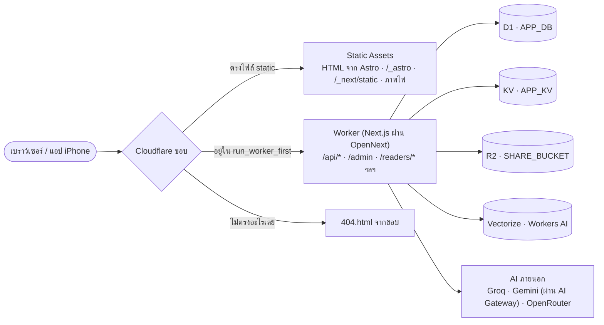
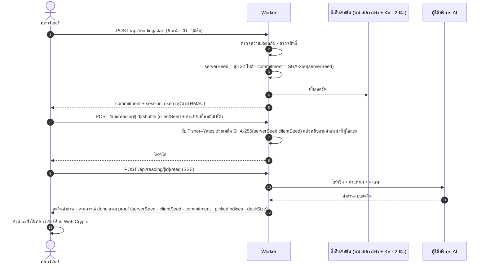

# สถาปัตยกรรมระบบ SeerTarot

> ตรวจกับโค้ดล่าสุด: 2026-10-26 (`wrangler.jsonc` · `astro.config.mjs` · `open-next.config.ts` · `scripts/merge-astro-assets.ts` · `src/lib/tarot/shuffle.ts` · `src/lib/ai/` · `src/lib/security/`)
> เลขรุ่นของไลบรารีดูที่ `package.json` · secret และบริการภายนอกดูที่ [PENDING_SETUP.md](PENDING_SETUP.md) · ขั้นตอน deploy ดูที่ [CLOUDFLARE_DEPLOYMENT_GUIDE.md](CLOUDFLARE_DEPLOYMENT_GUIDE.md)

## 1. หลักที่ระบบยึด

| หลัก | อยู่ในโค้ดตรงไหน |
| :--- | :--- |
| **AI ไม่เคยเป็นคนจั่วไพ่** — ไพ่มาจากเมล็ดของเซิร์ฟเวอร์ + เมล็ดของผู้ใช้ หรือคำนวณจากข้อมูลตั้งต้นที่ตรวจซ้ำได้ (วันเกิด · วันที่) เท่านั้น โมเดลแค่อ่านไพ่ที่ออกแล้ว | `src/lib/tarot/shuffle.ts` · `src/lib/reading/derived-draw.ts` |
| **ห้ามกุไพ่** — หาไพ่ไม่เจอให้คืน `undefined` หรือ error แล้วให้ผู้ใช้โหลดใหม่ (CLAUDE.md กฎข้อ 14) | ทุกเส้นทางเปิดไพ่ |
| **ผู้ใช้เลือกและพลิกไพ่เอง** — ไพ่บนผังเริ่มคว่ำหน้าเสมอ | `src/components/home/TarotFlow.tsx` · `src/components/spread/SpreadBoard.tsx` |
| **ความปลอดภัยมาก่อนคำทำนาย** — คำถามที่มีสัญญาณทำร้ายตัวเองถูกหยุดก่อนถึงโมเดล | `src/lib/safety/` |

## 2. ภาพรวม: สองเครื่องเรนเดอร์ บน Worker ตัวเดียว



### 2.1 เส้นทางไหนเสิร์ฟจากไหน

| เส้นทาง | เสิร์ฟโดย | โค้ดอยู่ที่ |
| :--- | :--- | :--- |
| หน้าเนื้อหาสาธารณะทั้งหมด: `/` · `/cards/**` · `/spreads/**` · `/blog/**` · `/pick-a-card/**` · `/questions/**` · `/love/**` · `/read/<ผัง>` · `/reading` · `/daily` · `/journal` · `/account` · `/pricing` · `/about` · `/contact` · `/privacy` และฉบับ `/en/...` | ไฟล์ HTML static ที่ Astro สร้างตอนบิลด์ — ขอบตอบเอง **ไม่ปลุก Worker** | `astro/pages/` |
| `/api/*` (118 route) · `/admin` · `/readers/*` · `/r/*` · `/s/*` · `/reset-password` · `/tester` · `/sitemap.xml` · `/robots.txt` · `/manifest.webmanifest` · `/_next/image*` | Worker — Next.js App Router ผ่าน `@opennextjs/cloudflare` | `src/app/` (หน้าแอปอยู่ใต้ `src/app/(th)/`) |
| เส้นทางที่ไม่ตรงไฟล์และไม่อยู่ในรายการข้างบน | `404.html` จากขอบ (`not_found_handling: "404-page"`) | — |

> ⚠️ **เพิ่มหน้าใหม่ที่ Next เป็นคนเรนเดอร์ (มี `page.tsx` หรือ `route.ts` นอก `/api`) ต้องเติมเส้นทางใน `assets.run_worker_first` ของ `wrangler.jsonc` ด้วยเสมอ** ไม่งั้นหน้านั้น 404 บน production · กลับกัน หน้าที่ย้ายไป Astro แล้ว (เช่น `/account`) ห้ามอยู่ในรายการนั้น ไม่งั้น Worker จะแย่งเส้นทางคืนจากไฟล์ static

### 2.2 บิลด์และ deploy

`npm run build:worker` (และ `deploy.yml` บน CI) ทำตามลำดับนี้:

1. `scripts/bump-sw-version.ts` — เปลี่ยนรุ่น service worker
2. `astro build` ➔ `dist/` (`srcDir: astro/` · `build.format: "file"` ได้ไฟล์แบบ `cards/major-00.html` · ไม่มี adapter)
3. `opennextjs-cloudflare build` ➔ `.open-next/` (ล้างโฟลเดอร์ทุกครั้ง จึงต้องมาก่อนขั้นถัดไป)
4. `scripts/merge-astro-assets.ts` — คัดลอก `dist/` ลง `.open-next/assets` · ถ้ามีไฟล์ชื่อซ้ำแต่เนื้อหาต่างกันจะหยุดบิลด์ (แปลว่ามีหน้าเดียวถูกเรนเดอร์สองที่) · เติมหัว `Link: rel=preload` ของ CSS ให้ Early Hints
5. CI เท่านั้น (`deploy.yml` หลังบิลด์และ `repo:verify` ผ่าน): `npm run db:migrate` (รัน `migrations/` ใส่ D1 remote) ➔ deploy ➔ ตรวจ Worker หลัง deploy (ไม่ผ่าน = ถอยรุ่นเอง) ➔ ขั้นเก็บงานอื่น (secret ของ Stripe · ล้างแคชขอบ · กฎ `www` · กฎลบการ์ดแชร์ใน R2)

แคชหน้าของ Next อยู่ใน static assets (`staticAssetsIncrementalCache` ใน `open-next.config.ts`) ไม่ได้อยู่ใน KV แล้ว (INC-0287)

### 2.3 คอมโพเนนต์ที่ใช้ร่วมกันสองฝั่ง

- คอมโพเนนต์ React ใน `src/components/` ถูกใช้ทั้งหน้า Next และ island ของ Astro
- ตอนบิลด์ด้วย Astro `next/link` · `next/navigation` · `next/script` · `next/dynamic` ถูกชี้ไปที่ `astro/shims/` (ตั้งใน `astro.config.mjs`) — ห้ามแก้คอมโพเนนต์ให้เลิกใช้ `next/*` เพื่อเรื่องนี้
- island อยู่ใน `astro/islands/` · กติกา island และกับดัก (เช่น import ข้อมูลก้อนใหญ่เข้า island แล้วบันเดิลพุ่ง) อยู่ใน [plans/HANDOFF_ASTRO_MIGRATION_2026-09-15.md](plans/HANDOFF_ASTRO_MIGRATION_2026-09-15.md)
- พิธีเปิดไพ่หลักคือ `src/components/home/TarotFlow.tsx` (island `TarotFlowRoot` บนหน้า `/` และ `/read/<ผัง>`)

### 2.4 โครงสร้างโฟลเดอร์

```text
astro/            หน้า Astro (pages/) · islands/ · components/ · layouts/BaseLayout.astro · shims/ · scripts/ (สคริปต์ฝั่งเบราว์เซอร์ขนาดเล็ก)
src/app/          Next.js — api/ (118 route) · (th)/ หน้าแอป · (en)/ · _shared/pages/ (ตัวหน้าที่ Astro เรียกใช้) · sitemap.ts · robots.ts · manifest.ts
src/components/   คอมโพเนนต์ React — home/ (TarotFlow) · spread/ · deck/ · card/ · reading/ · journal/ · readers/ · admin/ · ui/ ฯลฯ
src/lib/          ตรรกะ — ai/ · tarot/ · reading/ · safety/ · security/ · auth/ · entitlement/ · platform/ (D1 · KV) · journal/ · marketplace/ ฯลฯ
src/data/         ข้อมูล — cards/ (78 ใบ) · spreads.ts · pick-a-card*.ts · personas.ts · articles.ts · zodiac.ts
src/server/       ที่เก็บเซสชันเปิดไพ่ (store.ts)
migrations/       สคีมา D1 (0001 … 0035) — ใช้ทั้ง production และฐานในเครื่อง
scripts/          เครื่องมือ CLI · scripts/qa/ = ด่านตรวจ (นิยามรวมที่ CHECKS ใน scripts/github-auto.ts)
public/           ภาพไพ่ (public/cards/ + ไฟล์ย่อ WebP) · ฟอนต์ · _headers
mobile/           แอป iPhone (Expo) — ใช้ API ชุดเดียวกับเว็บ
```

## 3. Binding และที่เก็บข้อมูล

ทั้งหมดประกาศใน `wrangler.jsonc` · ตัวเข้าถึงอยู่ที่ `src/lib/platform/cf.ts` (KV) และ `src/lib/platform/db.ts` (D1)

| Binding | ชนิด | ใช้ทำอะไร |
| :--- | :--- | :--- |
| `ASSETS` | Static Assets (`.open-next/assets`) | หน้า Astro · ไฟล์ของ Next · ภาพไพ่ · ฟอนต์ |
| `APP_DB` | D1 (`tarot-app-db`) | ผู้ใช้ · สมุดดวง · สิทธิ์/โควตา · ระบบแม่หมอ · ตัวนับเพดานถี่ (`edge_rate_buckets`) ฯลฯ — สคีมาอยู่ใน `migrations/` · สำรองทุกสัปดาห์ลง R2 (`d1-backup.yml`) |
| `APP_KV` | KV | ข้อมูลแอปคีย์ `app:*` — ธง · ค่าที่แอดมินแก้ · ตัวนับ · เซสชันเปิดไพ่สำรอง (เดิมชื่อ `NEXT_INC_CACHE_KV` · เปลี่ยน 2026-10-24) |
| `SHARE_BUCKET` | R2 (`seertarot-share`) | ภาพการ์ดแชร์ (ลบเองเมื่อครบ 90 วัน · ตั้งกฎทุก deploy) · โลโก้สตูดิโอแม่หมอ `studio-logo/` (เก็บถาวร) |
| `VECTORIZE` | Vectorize (`card-meanings` · 1024 มิติ) | ค้นหาเชิงความหมายในหน้า `/cards` (`src/lib/search/vectorize.ts`) |
| `AI` | Workers AI | ตัวจำแนกสัญญาณวิกฤตชั้น 3 (`src/lib/safety/ai-classifier.ts`) · สร้าง embedding ให้ Vectorize |
| `CALL_METRICS` | Analytics Engine (`seertarot_calls`) | สถิติความเสถียรวิดีโอคอลแม่หมอ (`npm run cf:call-stats`) |

- **Workers Logs** เปิดอยู่ (`observability`) และตัด query string ออกจาก log
- **ในเครื่อง** ไม่มี binding จริง: D1 ถูกแทนด้วยไฟล์ SQLite `.dev-marketplace.db` ที่สร้างจาก `migrations/` อัตโนมัติ — ดู [LOCAL_SETUP.md](LOCAL_SETUP.md)
- ตาราง/คอลัมน์ใหม่ให้เพิ่มไฟล์ migration อย่างเดียว ห้ามเขียนสคีมาซ้ำในโค้ด (INC-0303)

## 4. Provably Fair — การสับไพ่ที่ตรวจได้



| ส่วน | รายละเอียด | ไฟล์ |
| :--- | :--- | :--- |
| คำมั่น | `commitment = SHA-256(serverSeed)` เป็น hex · ส่งให้ผู้ใช้ก่อนแตะไพ่ | `src/lib/tarot/shuffle.ts` |
| เมล็ดของผู้ใช้ | ต้องมาจากการขยับจริงของผู้ใช้และต้องไม่ว่าง — เซิร์ฟเวอร์ห้ามสุ่มแทน (`normalizeClientSeed` โยน error) | `shuffle.ts` |
| การสับ | สายเลขสุ่ม `SHA-256(seed:counter)` · Fisher–Yates · rejection sampling กันความเอนเอียง · โอกาสกลับหัว 40% | `shuffle.ts` |
| การตรวจ | ตัวตรวจฝั่งเบราว์เซอร์ให้ผลตรงกับฝั่งเซิร์ฟเวอร์ทุกไบต์ · แผงตรวจบนหน้าเว็บ | `src/lib/tarot/verify-client.ts` · `src/components/reading/ProvablyFairPanel.tsx` |
| เซสชัน | เก็บในหน่วยความจำ + KV (หรือ Upstash Redis เมื่อตั้งค่า) อายุ 2 ชั่วโมง · `sessionToken` ลงนามด้วย `TAROT_SESSION_SECRET` ใช้กู้เซสชันข้าม isolate | `src/server/store.ts` · `src/lib/security/session-token.ts` |
| ไพ่ที่คำนวณได้ | Pick a Card (สำรับประจำวัน) และไพ่วันเกิด **ไม่ได้มาจากการจั่ว** — เซิร์ฟเวอร์คำนวณจากข้อมูลตั้งต้นที่ตรึงไว้ตอน `/start` · proof แนบ `derivation` บอกเสมอ ห้ามแสดงคู่กับแผงตรวจการจั่ว | `src/lib/reading/derived-draw.ts` |

## 5. AI อ่านไพ่

| ลำดับ | ผู้ให้บริการ | โมเดล (ตามโค้ด 2026-10-26) | หมายเหตุ |
| :-: | :--- | :--- | :--- |
| 1 | Groq | `qwen/qwen3.8-27b` ➔ `openai/gpt-oss-120b` ➔ `openai/gpt-oss-20b` | ผังตั้งแต่ 4 ใบเกินเพดาน token ต่อนาทีของ Groq จึงข้ามไปลำดับ 2 ทันที · มีด่านกันอักษรต่างชาติหลุดในคำตอบ |
| 2 | Google Gemini | `gemini-3.5-flash-lite` ➔ `gemini-3.6-flash` (`WORKING_GEMINI_MODELS`) | รายชื่อมาจากผลวัดในแท็บ "สุขภาพ AI" ของแอดมินเท่านั้น ห้ามเดา (INC-0053) |
| 3 | OpenRouter | โมเดลฟรีเท่านั้น (`OPENROUTER_FREE_MODELS` · ตอนนี้ว่าง) | รายชื่อมาจาก `ai-probe-openrouter.yml` |
| 4 | คำอ่านสำรองออฟไลน์ | — | ใช้เมื่อทุกเจ้าล่มหรือไม่มีคีย์ (`src/lib/ai/mock-reading.ts`) |

- Groq และ Gemini วิ่งผ่าน Cloudflare AI Gateway เมื่อตั้ง `CF_AI_GATEWAY_*` (`src/lib/ai/gateway.ts`)
- สตรีมไปเบราว์เซอร์ด้วย Server-Sent Events · ผู้ใช้ปิดแท็บ = ยกเลิกคำขอไปยังผู้ให้บริการทันที
- prompt สร้างที่ `src/lib/ai/prompt.ts` (รุ่นใน `prompt-version.ts`) · กันการฉีดคำสั่งที่ `prompt-guard.ts` · ตรวจภาษาไทยที่ `thai-quality.ts` · คำตอบทุกชิ้นผ่าน `stripEmoji()` ก่อนถึงจอ
- คำอ่านทุกชิ้นแนบข้อความบอกว่าเขียนโดย AI (`AI_DISCLOSURE`)
- เส้นทางอื่นที่เรียก AI: แชทถามต่อ (`/api/reading/[id]/chat`) · ขอรายละเอียดเพิ่ม (`clarify`) · อธิบายเหตุผล (`explain`) · มุมมองเพิ่ม (`perspective`)

### 5.1 บุคลิกแม่หมอ (`src/data/personas.ts`)

| id | ชื่อ | น้ำเสียง |
| :--- | :--- | :--- |
| `warm` | แม่หมอใจดี | อบอุ่น โอบกอดความรู้สึก |
| `playful` | แม่หมอเพื่อนซี้ | คุยสนุก เป็นกันเอง |
| `direct` | แม่หมอพูดตรง | ไม่อ้อมค้อม ชี้จุดที่ต้องแก้ |
| `master` | อาจารย์สายฟันธง | จริงจัง ให้แผน 1-2-3 — เฉพาะผู้มีสิทธิ์พิเศษ |
| `mystic` | แม่หมอสายพลัง | อ่านพลังงานและจังหวะชีวิต — เฉพาะผู้มีสิทธิ์พิเศษ |

`master` และ `mystic` สงวนไว้ตาม `MASTER_PERSONA_IDS` ใน `src/lib/entitlement/limits.ts`

## 6. ความปลอดภัยและการคุมต้นทุน

| ชั้น | ทำอะไร | ไฟล์ |
| :--- | :--- | :--- |
| ด่านวิกฤต | regex จับประโยคตรง ➔ Workers AI จับประโยคอ้อม (ข้อความในกลุ่มเสี่ยงที่ตัวจำแนกล่ม = บล็อกไว้ก่อน) ➔ แสดงสายด่วน 1323 · สะมาริตันส์ · 1669 | `src/lib/safety/guardrails.ts` · `ai-classifier.ts` |
| กันเว็บอื่นยิง API | ตรวจ `Origin` / Fetch Metadata | `src/lib/security/anti-theft.ts` |
| เพดานความถี่ | ด่านเร็วในหน่วยความจำ + เพดานข้าม isolate แบบ atomic บน D1 (`edge_rate_buckets`) ทุกเส้นทางเปิดไพ่ | `src/lib/utils/rate-limit.ts` · `src/lib/security/edge-ratelimit.ts` |
| เพดานงบ AI รายวัน | `AI_DAILY_CALL_CAP` (ค่าเริ่มต้น 2,000 ครั้ง/วัน) · ผู้ไม่เป็นสมาชิกถูกตัดที่ 70% | `src/lib/security/ai-budget.ts` |
| สิทธิ์เปิดไพ่ | ต้องลงชื่อก่อน (`GUEST_LIMIT = 0`) · ผังมาตรฐานวันละ 1 ครั้ง (`DAILY_LIMIT`) · ผังใหญ่ใช้แพ็กเกจ | `src/lib/entitlement/` · [specs/ENTITLEMENT_ABUSE_MODEL.md](specs/ENTITLEMENT_ABUSE_MODEL.md) |
| กันบอทตอนสมัคร/ลงชื่อ | Cloudflare Turnstile (เมื่อตั้งคีย์) | `src/lib/security/turnstile.ts` |
| ทางข้ามสำหรับทดสอบ | ทีมงานและ CI ข้ามเพดานได้ด้วยรหัสลับเท่านั้น | `src/lib/security/privileged.ts` |
| ขอบ Cloudflare | กฎ WAF/Rate Limiting ตั้งที่ Dashboard — ไม่อยู่ในโค้ด | [CLOUDFLARE_DEPLOYMENT_GUIDE.md](CLOUDFLARE_DEPLOYMENT_GUIDE.md) หัวข้อ 6 |

เหตุผลที่ไม่ใช้ captcha ระหว่างเปิดไพ่: [adr/ADR-002-bot-challenge.md](adr/ADR-002-bot-challenge.md)

## 7. บัญชีผู้ใช้

| เรื่อง | รายละเอียด | ไฟล์ |
| :--- | :--- | :--- |
| ลงชื่อ | Google · LINE (`/api/auth/[provider]`) · อีเมล + รหัสผ่าน (`/api/auth/email/*`) | `src/app/api/auth/` |
| แฮชรหัสผ่าน | PBKDF2-HMAC-SHA256 100,000 รอบ (เพดานของ Web Crypto บน Workers) + pepper ฝั่งเซิร์ฟเวอร์ (`PASSWORD_PEPPER`) · เทียบแบบเวลาคงที่ | `src/lib/auth/password.ts` |
| นโยบายรหัสผ่าน | ยาว 10–200 ตัว · ปฏิเสธรหัสยอดนิยมและรหัสที่มีชื่ออีเมล | `src/lib/auth/password-policy.ts` |
| token ยืนยัน/รีเซ็ต | เก็บเฉพาะแฮช · ใช้ได้ครั้งเดียว · ยืนยันอีเมล 24 ชม. · รีเซ็ตรหัส 15 นาที | `src/lib/auth/auth-tokens.repo.ts` |
| เพิกถอนเซสชัน | เปลี่ยน/รีเซ็ตรหัสผ่านแล้ว `token_version` เพิ่ม เซสชันเดิมทุกเครื่องหลุด | `src/lib/auth/resolve-session.ts` |
| ส่งอีเมล | Resend (`RESEND_API_KEY`) · ไม่มีคีย์ในเครื่อง = พิมพ์อีเมลลง console | `src/lib/email/send.ts` |
| ข้อมูลส่วนบุคคล | ขอสำเนา `/api/account/export` · ลบ `DELETE /api/account` · ตารางใหม่ที่มี `user_id` ต้องลงทะเบียนที่เดียว | `src/lib/privacy/user-data.ts` |

## 8. การตัดสินใจทางสถาปัตยกรรม (ADR) และเอกสารที่เกี่ยวข้อง

- [ADR-001](adr/ADR-001-marketplace-pdpa.md) — ข้อมูลส่วนบุคคลในระบบแม่หมอ
- [ADR-002](adr/ADR-002-bot-challenge.md) — กันบอทและคุมต้นทุน AI โดยไม่ใช้ captcha
- [ADR-003](adr/ADR-003-cutting-edge-stack-rationale.md) — เหตุผลที่ใช้ไลบรารีรุ่นใหม่ (เลขรุ่นในไฟล์เป็นของวันที่เขียน)
- [plans/HANDOFF_ASTRO_MIGRATION_2026-09-15.md](plans/HANDOFF_ASTRO_MIGRATION_2026-09-15.md) — ย้ายหน้าเนื้อหาไป Astro · กติกา island
- [plans/HANDOFF_CARD_TILE_CV_2026-09-15.md](plans/HANDOFF_CARD_TILE_CV_2026-09-15.md) — สูตรความสูงการ์ดไพ่ในกริด
- [specs/MARKETPLACE.md](specs/MARKETPLACE.md) — ระบบแม่หมอตัวจริง
- [TAROT_CARD_FEATURES.md](TAROT_CARD_FEATURES.md) — สเปกโดเมนไพ่ (สำรับ · ผัง · Pick a Card)
