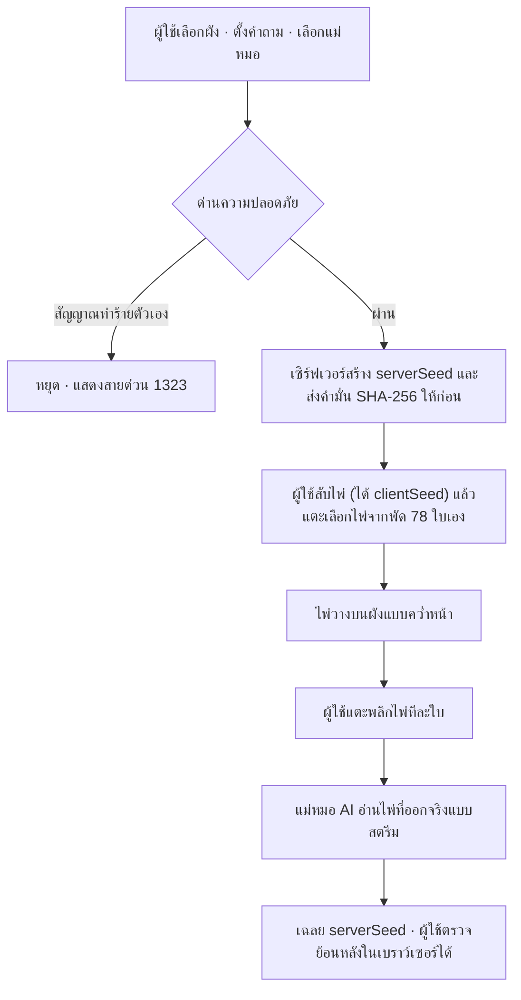

# สเปกโดเมนไพ่ทาโรต์ SeerTarot

> **สถานะ**: เอกสารอ้างอิงหลัก (canonical spec) ของโดเมนไพ่ — สำรับ · ความหมาย · ผัง · Pick a Card · ราศี · การสับไพ่ · ตรวจกับโค้ดล่าสุด: 2026-10-27
> **แหล่งความจริงคือโค้ด** (`src/data/` · `src/lib/tarot/` · `src/lib/reading/`) — ตารางในไฟล์นี้ดึงจากข้อมูลในโค้ด ณ วันที่ตรวจ ถ้าวันหนึ่งไม่ตรงกัน ให้ถือโค้ดเป็นหลักแล้วแก้ไฟล์นี้
> ใช้เป็นบริบทความรู้ให้ AI (เช่น NotebookLM) และเป็นคู่มืออ้างอิงของทีมพัฒนา · กติกาที่เกี่ยวกับไพ่ (ห้ามกุไพ่ · เปิดไพ่เอง · ภาพ 1909 · ท่อภาพไพ่ · ผังใหญ่ห้ามล้นกรอบ) อยู่ใน [CLAUDE.md](../CLAUDE.md) กฎเหล็ก ไม่ซ้ำที่นี่

## สารบัญ

1. [เส้นทางการเปิดไพ่หนึ่งครั้ง](#1-เส้นทางการเปิดไพ่หนึ่งครั้ง)
2. [สำรับ 78 ใบ](#2-สำรับ-78-ใบ)
3. [ความหมาย 5 หมวด](#3-ความหมาย-5-หมวด)
4. [ผังพยากรณ์ 26 ผัง](#4-ผังพยากรณ์-26-ผัง)
5. [Pick a Card](#5-pick-a-card)
6. [ไพ่ × 12 ราศี และไพ่วันเกิด](#6-ไพ่--12-ราศี-และไพ่วันเกิด)
7. [การสับไพ่ที่ตรวจได้](#7-การสับไพ่ที่ตรวจได้)
8. [หน้าจอและการโต้ตอบ](#8-หน้าจอและการโต้ตอบ)
9. [แม่หมอ AI และความปลอดภัย](#9-แม่หมอ-ai-และความปลอดภัย)

## 1. เส้นทางการเปิดไพ่หนึ่งครั้ง



- ขั้นตอนบนหน้าเว็บ (`src/components/home/ritual-step.ts`): เลือกผัง ➔ ตั้งคำถาม/เลือกแม่หมอ ➔ สับ ➔ เลือกไพ่ ➔ อ่าน ➔ สรุป
- ต้องลงชื่อก่อนเปิดไพ่ · สิทธิ์ฟรีและเพดานอยู่ใน `src/lib/entitlement/limits.ts` (ดูหัวข้อ 4.2)

## 2. สำรับ 78 ใบ

| กลุ่ม | จำนวน | รหัส |
| :--- | :-: | :--- |
| Major Arcana | 22 | `major-00` … `major-21` |
| ไม้เท้า · ถ้วย · ดาบ · เหรียญ | 14 ต่อชุด (รวม 56) | `wands-01` … `wands-14` (เอซ = 01 · เพจ = 11 · อัศวิน = 12 · ราชินี = 13 · ราชา = 14) |

- ข้อมูลอยู่ที่ `src/data/cards/` (`major-a.ts` · `major-b.ts` · `wands.ts` · `cups.ts` · `swords.ts` · `pentacles.ts` · ความหมายอังกฤษใน `meanings-en/`) · ภาพ `public/cards/<รหัส>.jpg`
- **ชื่อไทยของไพ่ชุดเล็กมีรูปแบบเดียว** `<ลำดับ>แห่ง<ชุด>` เช่น เอซแห่งไม้เท้า · สองแห่งถ้วย · เพจแห่งเหรียญ · ราชาแห่งดาบ (เจ้าของเลือก 2026-10-11 · `scripts/verify-cards.ts` บังคับ) — ห้ามเขียน "ไม้เท้า 2" หรือ "สองถ้วย"
- ช่อง "ใช่/ไม่" คือ `yesNo` ที่ผังใช่หรือไม่ใช้ (`yes` · `no` · `maybe`)

### 2.1 Major Arcana (22 ใบ)

| ID | เลข | ชื่อไทย | ชื่ออังกฤษ | คำสำคัญหัวตั้ง (3 คำแรก) | ธาตุ | โหราศาสตร์ | ใช่/ไม่ |
| :--- | :-: | :--- | :--- | :--- | :-: | :--- | :-: |
| `major-00` | 0 | คนเขลา | The Fool | เริ่มต้นใหม่ · อิสระ · ไร้เดียงสา | ลม | ดาวยูเรนัส | maybe |
| `major-01` | 1 | นักมายากล | The Magician | ลงมือทำ · ความสามารถ · โฟกัส | ลม | ดาวพุธ | yes |
| `major-02` | 2 | นักบวชหญิง | The High Priestess | สัญชาตญาณ · ความลับ · เงียบสงบ | น้ำ | ดวงจันทร์ | maybe |
| `major-03` | 3 | จักรพรรดินี | The Empress | ความอุดมสมบูรณ์ · การดูแล · ความคิดสร้างสรรค์ | ดิน | ดาวศุกร์ | yes |
| `major-04` | 4 | จักรพรรดิ | The Emperor | ความมั่นคง · ระเบียบ · ผู้นำ | ไฟ | ราศีเมษ | yes |
| `major-05` | 5 | นักบวช | The Hierophant | ขนบธรรมเนียม · ครูผู้สอน · ความเชื่อ | ดิน | ราศีพฤษภ | yes |
| `major-06` | 6 | คู่รัก | The Lovers | ทางเลือก · ความผูกพัน · ความกลมกลืน | ลม | ราศีเมถุน | yes |
| `major-07` | 7 | ราชรถ | The Chariot | มุ่งมั่น · ชัยชนะ · ควบคุมทิศทาง | น้ำ | ราศีกรกฎ | yes |
| `major-08` | 8 | พลัง | Strength | ความกล้าจากข้างใน · อดทน · อ่อนโยนแต่หนักแน่น | ไฟ | ราศีสิงห์ | yes |
| `major-09` | 9 | ฤๅษี | The Hermit | ทบทวนตัวเอง · ปลีกวิเวก · หาคำตอบข้างใน | ดิน | ราศีกันย์ | maybe |
| `major-10` | 10 | กงล้อแห่งโชคชะตา | Wheel of Fortune | จุดเปลี่ยน · โชคเข้าข้าง · วัฏจักร | ไฟ | ดาวพฤหัสบดี | yes |
| `major-11` | 11 | ความยุติธรรม | Justice | ความเป็นธรรม · สมดุล · รับผิดชอบ | ลม | ราศีตุลย์ | maybe |
| `major-12` | 12 | ชายผู้ถูกแขวน | The Hanged Man | หยุดรอ · มองมุมใหม่ · ยอมปล่อย | น้ำ | ดาวเนปจูน | no |
| `major-13` | 13 | ความตาย | Death | จบเพื่อเริ่มใหม่ · เปลี่ยนผ่าน · ปล่อยวาง | น้ำ | ราศีพิจิก | no |
| `major-14` | 14 | ความพอดี | Temperance | สมดุล · ค่อยเป็นค่อยไป · ผสมผสาน | ไฟ | ราศีธนู | yes |
| `major-15` | 15 | ปีศาจ | The Devil | ความยึดติด · พันธนาการ · ความอยาก | ดิน | ราศีมังกร | no |
| `major-16` | 16 | หอคอย | The Tower | เปลี่ยนกะทันหัน · ความจริงปรากฏ · รื้อของเก่า | ไฟ | ดาวอังคาร | no |
| `major-17` | 17 | ดวงดาว | The Star | ความหวัง · ฟื้นตัว · แรงบันดาลใจ | ลม | ราศีกุมภ์ | yes |
| `major-18` | 18 | ดวงจันทร์ | The Moon | ความไม่ชัดเจน · ความกลัว · สัญชาตญาณ | น้ำ | ราศีมีน | no |
| `major-19` | 19 | ดวงอาทิตย์ | The Sun | ความสำเร็จ · ความสุข · ความชัดเจน | ไฟ | ดวงอาทิตย์ | yes |
| `major-20` | 20 | การตื่นขึ้น | Judgement | ตื่นรู้ · เรียกร้องภายใน · ให้อภัย | ไฟ | ดาวพลูโต | yes |
| `major-21` | 21 | โลก | The World | ครบรอบ · สำเร็จ · เต็มเต็ม | ดิน | ดาวเสาร์ | yes |

### 2.2 Minor Arcana (56 ใบ)

#### ชุดไม้เท้า (Wands) · ธาตุไฟ · ไฟชีวิต ปณิธาน การลงมือทำ

| ID | ชื่อไทย | ชื่ออังกฤษ | คำสำคัญ (หัวตั้ง) | ใช่/ไม่ |
| :--- | :--- | :--- | :--- | :---: |
| `wands-01` | เอซแห่งไม้เท้า | Ace of Wands | ประกายไฟแรก · แรงบันดาลใจ · โอกาสใหม่ | yes |
| `wands-02` | สองแห่งไม้เท้า | Two of Wands | วางแผน · มองไกล · ตัดสินใจ | maybe |
| `wands-03` | สามแห่งไม้เท้า | Three of Wands | ผลเริ่มเดิน · ขยายวง · รอผลตอบรับ | yes |
| `wands-04` | สี่แห่งไม้เท้า | Four of Wands | เฉลิมฉลอง · บ้าน · ความมั่นคง | yes |
| `wands-05` | ห้าแห่งไม้เท้า | Five of Wands | แข่งขัน · ปะทะความเห็น · วุ่นวาย | no |
| `wands-06` | หกแห่งไม้เท้า | Six of Wands | ชัยชนะ · ได้รับการยอมรับ · ความภูมิใจ | yes |
| `wands-07` | เจ็ดแห่งไม้เท้า | Seven of Wands | ยืนหยัด · ปกป้องจุดยืน · กล้าค้าน | no |
| `wands-08` | แปดแห่งไม้เท้า | Eight of Wands | เร็ว · ข่าวสาร · ทุกอย่างขยับพร้อมกัน | yes |
| `wands-09` | เก้าแห่งไม้เท้า | Nine of Wands | ทนมาไกล · เหลืออีกนิด · ตั้งการ์ด | no |
| `wands-10` | สิบแห่งไม้เท้า | Ten of Wands | แบกหนัก · รับผิดชอบเกินตัว · ใกล้ถึงแต่ล้า | no |
| `wands-11` | เพจแห่งไม้เท้า | Page of Wands | อยากลองของใหม่ · ข่าวดี · ความสดใส | yes |
| `wands-12` | อัศวินแห่งไม้เท้า | Knight of Wands | พุ่งไปข้างหน้า · กล้าเสี่ยง · เสน่ห์แรง | maybe |
| `wands-13` | ราชินีแห่งไม้เท้า | Queen of Wands | มั่นใจ · อบอุ่นและมีเสน่ห์ · ดึงดูดคน | yes |
| `wands-14` | ราชาแห่งไม้เท้า | King of Wands | ผู้นำ · วิสัยทัศน์ · กล้าตัดสินใจ | yes |

#### ชุดถ้วย (Cups) · ธาตุน้ำ · อารมณ์ ความรัก สายสัมพันธ์

| ID | ชื่อไทย | ชื่ออังกฤษ | คำสำคัญ (หัวตั้ง) | ใช่/ไม่ |
| :--- | :--- | :--- | :--- | :---: |
| `cups-01` | เอซแห่งถ้วย | Ace of Cups | ใจที่เปิด · ความรู้สึกใหม่ · ความรักบริสุทธิ์ | yes |
| `cups-02` | สองแห่งถ้วย | Two of Cups | ใจตรงกัน · คู่แท้ · ความผูกพัน | yes |
| `cups-03` | สามแห่งถ้วย | Three of Cups | มิตรภาพ · การเฉลิมฉลอง · กลุ่มคนที่ใช่ | yes |
| `cups-04` | สี่แห่งถ้วย | Four of Cups | เบื่อหน่าย · มองข้ามโอกาส · ทบทวนตัวเอง | no |
| `cups-05` | ห้าแห่งถ้วย | Five of Cups | ความเสียใจ · การสูญเสีย · เสียดายอดีต | no |
| `cups-06` | หกแห่งถ้วย | Six of Cups | ความทรงจำ · คนเก่ากลับมา · ความบริสุทธิ์ใจ | maybe |
| `cups-07` | เจ็ดแห่งถ้วย | Seven of Cups | ทางเลือกมาก · ภาพลวง · เพ้อฝัน | no |
| `cups-08` | แปดแห่งถ้วย | Eight of Cups | จากลา · ออกเดินทาง · หาความหมาย | no |
| `cups-09` | เก้าแห่งถ้วย | Nine of Cups | สมหวัง · ความพอใจ · ความสุขส่วนตัว | yes |
| `cups-10` | สิบแห่งถ้วย | Ten of Cups | ครอบครัว · ความสุขที่ยั่งยืน · ความกลมเกลียว | yes |
| `cups-11` | เพจแห่งถ้วย | Page of Cups | ข่าวดีเรื่องใจ · ความอ่อนโยน · ความคิดสร้างสรรค์ | maybe |
| `cups-12` | อัศวินแห่งถ้วย | Knight of Cups | คำเชิญชวน · โรแมนติก · ตามเสียงหัวใจ | maybe |
| `cups-13` | ราชินีแห่งถ้วย | Queen of Cups | เข้าอกเข้าใจ · สัญชาตญาณแม่นยำ · ใจเย็น | yes |
| `cups-14` | ราชาแห่งถ้วย | King of Cups | ใจนิ่ง · ที่ปรึกษาที่ดี · ควบคุมอารมณ์ได้ | yes |

#### ชุดดาบ (Swords) · ธาตุลม · ความคิด ความจริง การตัดสินใจ

| ID | ชื่อไทย | ชื่ออังกฤษ | คำสำคัญ (หัวตั้ง) | ใช่/ไม่ |
| :--- | :--- | :--- | :--- | :---: |
| `swords-01` | เอซแห่งดาบ | Ace of Swords | ความชัดเจน · ความจริง · ไอเดียใหม่ | yes |
| `swords-02` | สองแห่งดาบ | Two of Swords | ลังเล · ทางสองแพร่ง · ปิดตาไม่มอง | maybe |
| `swords-03` | สามแห่งดาบ | Three of Swords | ความเจ็บจากความจริง · ผิดหวัง · คำพูดที่กระทบใจ | no |
| `swords-04` | สี่แห่งดาบ | Four of Swords | พักผ่อน · ถอยตั้งหลัก · ความเงียบ | maybe |
| `swords-05` | ห้าแห่งดาบ | Five of Swords | ความขัดแย้ง · ชนะแต่ไม่คุ้ม · ทิฐิ | no |
| `swords-06` | หกแห่งดาบ | Six of Swords | เปลี่ยนผ่าน · ย้ายออกจากที่เดิม · น้ำนิ่งขึ้น | maybe |
| `swords-07` | เจ็ดแห่งดาบ | Seven of Swords | ชั้นเชิง · เรื่องที่ยังไม่ถูกพูด · ปิดบัง | no |
| `swords-08` | แปดแห่งดาบ | Eight of Swords | รู้สึกติดกับ · กรอบในหัว · ไม่กล้าขยับ | no |
| `swords-09` | เก้าแห่งดาบ | Nine of Swords | ความกังวล · คิดมากตอนกลางคืน · ความกลัวในหัว | no |
| `swords-10` | สิบแห่งดาบ | Ten of Swords | จุดต่ำสุดผ่านไปแล้ว · บทหนึ่งปิดลง · หมดแรง | no |
| `swords-11` | เพจแห่งดาบ | Page of Swords | อยากรู้อยากเห็น · ข่าวสาร · เริ่มเรียนรู้ | maybe |
| `swords-12` | อัศวินแห่งดาบ | Knight of Swords | พุ่งไปข้างหน้า · ตัดสินใจเร็ว · กล้าพูด | no |
| `swords-13` | ราชินีแห่งดาบ | Queen of Swords | สายตาคม · พูดตรงแต่หวังดี · มีขอบเขต | maybe |
| `swords-14` | ราชาแห่งดาบ | King of Swords | เหตุผล · หลักการ · ผู้ใหญ่ที่พึ่งได้ | maybe |

#### ชุดเหรียญ (Pentacles) · ธาตุดิน · เงิน งาน ความมั่นคง

| ID | ชื่อไทย | ชื่ออังกฤษ | คำสำคัญ (หัวตั้ง) | ใช่/ไม่ |
| :--- | :--- | :--- | :--- | :---: |
| `pentacles-01` | เอซแห่งเหรียญ | Ace of Pentacles | โอกาสใหม่ · เมล็ดพันธุ์ · รากฐาน | yes |
| `pentacles-02` | สองแห่งเหรียญ | Two of Pentacles | สมดุล · ยืดหยุ่น · จัดลำดับ | maybe |
| `pentacles-03` | สามแห่งเหรียญ | Three of Pentacles | ทีมเวิร์ก · ฝีมือ · การยอมรับ | yes |
| `pentacles-04` | สี่แห่งเหรียญ | Four of Pentacles | ความมั่นคง · เก็บออม · ระมัดระวัง | no |
| `pentacles-05` | ห้าแห่งเหรียญ | Five of Pentacles | ช่วงขัดสน · ความเหงา · มองข้ามความช่วยเหลือ | no |
| `pentacles-06` | หกแห่งเหรียญ | Six of Pentacles | การให้และรับ · ความเอื้อเฟื้อ · ความช่วยเหลือ | yes |
| `pentacles-07` | เจ็ดแห่งเหรียญ | Seven of Pentacles | รอผล · ประเมินผล · ความอดทน | maybe |
| `pentacles-08` | แปดแห่งเหรียญ | Eight of Pentacles | ฝึกฝน · ตั้งใจทำ · พัฒนาทักษะ | yes |
| `pentacles-09` | เก้าแห่งเหรียญ | Nine of Pentacles | พึ่งพาตัวเองได้ · ผลของความอดทน · ความสง่างาม | yes |
| `pentacles-10` | สิบแห่งเหรียญ | Ten of Pentacles | ครอบครัว · รากฐานมั่นคง · ความมั่นคงระยะยาว | yes |
| `pentacles-11` | เพจแห่งเหรียญ | Page of Pentacles | เริ่มเรียนรู้ · ความอยากรู้ · ตั้งใจจริง | yes |
| `pentacles-12` | อัศวินแห่งเหรียญ | Knight of Pentacles | สม่ำเสมอ · น่าเชื่อถือ · ทำทีละขั้น | maybe |
| `pentacles-13` | ราชินีแห่งเหรียญ | Queen of Pentacles | ดูแลคน · อบอุ่น · จัดการเก่ง | yes |
| `pentacles-14` | ราชาแห่งเหรียญ | King of Pentacles | มั่นคง · ผู้นำที่ไว้ใจได้ · สร้างมาด้วยตัวเอง | yes |

## 3. ความหมาย 5 หมวด

ไพ่ทุกใบมีความหมายครบ 5 หมวด ทั้งหัวตั้งและกลับหัว ทั้งไทยและอังกฤษ = 78 × 5 × 2 = 780 ข้อความต่อภาษา (ตรวจ 2026-10-27: ครบ ไม่มีช่องว่าง)

```typescript
// ย่อจาก src/data/cards/types.ts
export type Category = "general" | "love" | "work" | "money" | "self";

export interface Interpretation {
  upright: string;  // หัวตั้ง 2-4 ประโยค
  reversed: string; // กลับหัว 2-4 ประโยค
}

export interface TarotCard {
  id: string;                    // "major-00", "wands-01"
  arcana: "major" | "minor";
  suit: "wands" | "cups" | "swords" | "pentacles" | null;
  number: number;                // Major 0-21 · Minor 1-14
  nameTh: string;
  nameEn: string;
  keywords: { upright: string[]; reversed: string[] };
  keywordsEn?: { upright: string[]; reversed: string[] };
  meanings: Record<Category, Interpretation>;
  meaningsEn?: Record<Category, Interpretation>;
  element: "ไฟ" | "น้ำ" | "ลม" | "ดิน";
  astrology: string;             // + astrologyEn
  numerology: string;            // + numerologyEn
  yesNo: "yes" | "no" | "maybe";
  image: string;                 // "major-00.jpg"
}
```

| หมวด | ครอบคลุม |
| :--- | :--- |
| `general` ทั่วไป | แก่นของสถานการณ์ พลังงานรวม และบทเรียนตอนนี้ |
| `love` ความรัก | ใจของทั้งสองฝ่าย แนวโน้มของคนโสด คนคุย แฟนเก่า และคู่รัก |
| `work` การงาน | บรรยากาศงาน ข้อตกลง ความก้าวหน้า จุดเสี่ยง และการตัดสินใจ |
| `money` การเงิน | สภาพคล่อง หนี้ รายได้ จุดรั่ว และความเสี่ยงในการลงทุน |
| `self` ตัวเอง | สิ่งที่ลงมือทำได้จริง การดูแลใจ และการเติบโตของตัวเอง |

### 3.1 ข้อมูลประกอบอื่นใน `src/data/cards/`

| ไฟล์ | มีอะไร | สถานะ |
| :--- | :--- | :--- |
| `card-advice.ts` | คำแนะนำลงมือทำรายใบ 78 ใบ × หัวตั้ง/กลับหัว (ใช้ในคำอ่านสำรองออฟไลน์) | แม่หมอตรวจครบแล้ว 2026-10-11 |
| `combos.ts` | คู่ไพ่ที่นักอ่านไพ่ใช้จริง 65 คู่ (`CURATED_COMBOS`) | ใช้เฉพาะแถวที่คนตรวจแล้ว |
| `reversal-angles.ts` | มุมอ่านกลับหัวรายใบ | ร่าง รอแม่หมอตรวจ ([review/READER_REVIEW_2026-10-11.md](review/READER_REVIEW_2026-10-11.md)) — ห้ามถึงมือผู้ใช้และห้ามเข้า prompt |
| `themes.ts` | ป้ายแก่นเรื่อง 1–3 ป้ายต่อทิศ ใช้หาไพ่ที่ชี้เรื่องเดียวกันในผัง (`src/lib/tarot/relations.ts`) | ใช้งาน |
| `reflection-prompts.ts` | คำถามสะท้อนตัวเองประจำไพ่ ใช้ในหน้า `/daily` | ใช้งาน |
| `visual-lore.ts` · `visual-lore-en.ts` | สัญลักษณ์ในภาพ 1909 รายใบ ส่งให้ AI ใช้บรรยาย | ใช้งาน |
| `yes-no.ts` | ถ้อยคำคำตอบใช่/ไม่ใช่ | ใช้งาน |

## 4. ผังพยากรณ์ 26 ผัง

- ผังสาธารณะ 26 ผัง รวม 136 ตำแหน่ง (`PUBLIC_SPREADS` ใน `src/data/spreads.ts`) · ทุกตำแหน่งมีชื่อ ความหมาย และพิกัด `x` `y` บนโต๊ะ
- ผังภายในอีก 3 ผังไม่อยู่ในคลัง ใช้เป็นท่อให้หน้าเฉพาะทางเรียก AI: `love-one` · `birth-card` · `pick-a-card`
- ผู้ใช้สร้างผังเองได้ 1–7 ใบ (`custom` · `src/lib/tarot/custom-spread.ts`)
- การวางไพ่บนจอใช้พิกัดจริงของผังผ่าน `mapLayout()` (`src/lib/tarot/spread-map-geometry.ts`) · กติกาผัง 7 ใบขึ้นไปดู CLAUDE.md กฎข้อ 9

### 4.1 รายชื่อผังตาม 6 หมวดในหน้า `/spreads`

หมวดมาจาก `src/data/spread-shelves.ts` (ทุกผังต้องอยู่หมวดเดียวพอดี — ด่าน `test-spreads`) · แอปมือถือใช้อีกชุดหนึ่งใน `src/data/spread-categories.ts`

| หมวด | id | ชื่อ | ใบ | สิทธิ์ |
| :--- | :--- | :--- | :-: | :--- |
| ถามด่วน ได้คำตอบไว | `daily` | ดวงรายวัน | 1 | ฟรีรายวัน |
| ถามด่วน ได้คำตอบไว | `quick` | ถามไวตอบตรง | 1 | ฟรีรายวัน |
| ถามด่วน ได้คำตอบไว | `yes-no` | ใช่หรือไม่ | 3 | ฟรีรายวัน |
| ถามด่วน ได้คำตอบไว | `three-card` | อดีต-ปัจจุบัน-อนาคต | 3 | ฟรีรายวัน |
| ถามด่วน ได้คำตอบไว | `situation-solution` | ปัญหาและทางออก | 3 | ฟรีรายวัน |
| ความรัก | `how-they-feel` | ความในใจของเขา | 4 | ฟรีรายวัน |
| ความรัก | `love` | ดวงความรักสองหัวใจ | 5 | ต้องมีสิทธิ์พิเศษ |
| ความรัก | `ex-reconciliation` | แฟนเก่าจะกลับมาไหม | 4 | ต้องมีสิทธิ์พิเศษ |
| ความรัก | `soulmate` | ตามหาเนื้อคู่แท้ | 5 | ต้องมีสิทธิ์พิเศษ |
| ความรัก | `love-six` | ดวงความรักเจาะลึก | 6 | ต้องมีสิทธิ์พิเศษ |
| การงาน การเงิน การเรียน | `career` | ดวงการงานและความก้าวหน้า | 5 | ต้องมีสิทธิ์พิเศษ |
| การงาน การเงิน การเรียน | `career-switch` | ย้ายงานหรืออยู่ที่เดิม | 5 | ต้องมีสิทธิ์พิเศษ |
| การงาน การเงิน การเรียน | `inner-potential` | ปลดล็อกพลังในตัวคุณ | 4 | ต้องมีสิทธิ์พิเศษ |
| การงาน การเงิน การเรียน | `money` | ดวงการเงินและโชคลาภ | 4 | ต้องมีสิทธิ์พิเศษ |
| การงาน การเงิน การเรียน | `luck` | ดวงโชคลาภและการเสี่ยงโชค | 4 | ฟรีรายวัน |
| การงาน การเงิน การเรียน | `study` | ดวงการเรียนและการสอบ | 4 | ฟรีรายวัน |
| ใจ ตัวเอง และคนรอบตัว | `mind-body-spirit` | กาย-ใจ-จิตวิญญาณ | 3 | ฟรีรายวัน |
| ใจ ตัวเอง และคนรอบตัว | `decision` | ทางแยกสองทาง: เลือก A หรือ B | 5 | ต้องมีสิทธิ์พิเศษ |
| ใจ ตัวเอง และคนรอบตัว | `family` | ดวงครอบครัวและคนรอบข้าง | 5 | ฟรีรายวัน |
| ใจ ตัวเอง และคนรอบตัว | `chakra` | สแกนสมดุล 7 จักระ | 7 | ต้องมีสิทธิ์พิเศษ |
| ดวงตามช่วงเวลา | `weekly` | ดวงรายสัปดาห์ 7 วัน | 7 | ต้องมีสิทธิ์พิเศษ |
| ดวงตามช่วงเวลา | `monthly` | ดวงรายเดือน 4 สัปดาห์ | 4 | ต้องมีสิทธิ์พิเศษ |
| ดวงตามช่วงเวลา | `monthly-ten` | ดวงรายเดือนเจาะลึก | 10 | ต้องมีสิทธิ์พิเศษ |
| ผังใหญ่เจาะลึก | `celtic-cross` | ส่องชะตาเจาะลึก 10 มิติ | 10 | ต้องมีสิทธิ์พิเศษ |
| ผังใหญ่เจาะลึก | `year-ahead` | ดวงรายปี 12 เดือน | 12 | ต้องมีสิทธิ์พิเศษ |
| ผังใหญ่เจาะลึก | `twelve-houses` | ดวงชะตา 12 เรือน | 12 | ต้องมีสิทธิ์พิเศษ |

### 4.2 สิทธิ์เปิดผัง

- **ฟรีรายวัน**: สมาชิกเปิดได้วันละ 1 ครั้ง (`DAILY_LIMIT`) — รายชื่ออยู่ใน `src/data/spreads/standard-ids.generated.ts` (ผังที่ `guestAllowed: true`) รวมผังภายในทั้งสามด้วย · ผังที่สร้างเอง 1–3 ใบนับเป็นผังมาตรฐาน
- **ต้องมีสิทธิ์พิเศษ**: ลองฟรีได้ครั้งแรก 1 ครั้ง จากนั้นใช้สิทธิ์ที่ซื้อหรือรหัสแลกสิทธิ์ · ผังที่สร้างเอง 4–7 ใบนับเป็นผังกลุ่มนี้
- ผู้ที่ยังไม่ลงชื่อเปิดไพ่ไม่ได้ (`GUEST_LIMIT = 0`) · กติกากันโกงดู [specs/ENTITLEMENT_ABUSE_MODEL.md](specs/ENTITLEMENT_ABUSE_MODEL.md)

## 5. Pick a Card

เลือก 1 จาก 4 กอง แล้วได้ไพ่ 3 ใบพร้อมคำอ่าน — หัวข้อและกองอยู่ใน `src/data/pick-a-card.ts` · คลังคำอ่านอยู่ใน `src/data/pick-a-card-readings.ts` (ฝั่งเซิร์ฟเวอร์เท่านั้น ห้าม import เข้าโค้ดฝั่งเบราว์เซอร์)

| # | id | URL (`/pick-a-card/<slug>` · `/en/pick-a-card/<slug>`) | หัวข้อ | หมวด |
| :-: | :--- | :--- | :--- | :--- |
| 1 | `love-feelings` | `how-they-feel-about-you` | เขาคิดยังไงกับเราในตอนนี้? | love |
| 2 | `love-future` | `future-of-your-relationship` | ทิศทางความรัก และความสัมพันธ์ในอนาคต | love |
| 3 | `career-finance` | `next-step-career-finance` | ก้าวต่อไปเรื่องงาน และโอกาสการเงินใหม่ | career |
| 4 | `universe-guidance` | `urgent-message-from-the-universe` | ข้อความเตือนสติ ที่จักรวาลอยากบอกคุณ | spiritual |
| 5 | `ex-return` | `will-they-come-back` | เขาจะกลับมาไหม? | love |
| 6 | `incoming-person` | `who-is-coming-into-your-life` | คนที่กำลังจะเข้ามาในชีวิต | love |
| 7 | `money-month` | `money-luck-this-month` | ดวงการเงินเดือนนี้ | career |
| 8 | `others-view` | `what-people-think-of-you` | สิ่งที่คนรอบตัวคิดกับคุณ | spiritual |

- **4 กองทุกหัวข้อ**: โรสควอตซ์ · อเมทิสต์ · ซิทริน · ลาปิส ลาซูลี
- **คำอ่าน 3 ส่วน**: ใบที่ 1 สถานการณ์ตอนนี้ (`currentSituation`) · ใบที่ 2 สิ่งที่ซ่อนอยู่ (`hiddenLayer`) · ใบที่ 3 คำแนะนำ (`oracleAdvice`) — ย่อหน้าของแต่ละส่วนอ้างได้เฉพาะไพ่ของตำแหน่งตัวเอง
- **สำรับประจำวัน** (`src/lib/reading/derived-draw.ts`): ไพ่คำนวณจาก หัวข้อ + กอง + วันที่ตามเวลาไทย ที่เซิร์ฟเวอร์ตรึงไว้ตอนเปิดเซสชัน — วันเดียวกันทุกคนได้ชุดเดียวกัน · วันเดียวกัน 4 กองได้คนละชุด · เปิดกองเดิมพรุ่งนี้ไม่ได้ไพ่ใบเดิม
- คลังคำอ่านหัวข้อละ 8 ชุด · ไพ่ทั้งสามตำแหน่งเดินด้วยลำดับแยกกัน วนครบรอบที่ 64 ชุดต่อกอง (8 × 8)
- ไพ่ชุดนี้ **คำนวณได้ ไม่ได้จั่ว** จึงไม่แสดงแผงตรวจการจั่ว (proof แนบ `derivation` บอกเสมอ) · ทุกกองผ่านท่อ AI และกติกาสิทธิ์เหมือนการเปิดไพ่ปกติ

## 6. ไพ่ × 12 ราศี และไพ่วันเกิด

- ข้อมูลราศี: `src/data/zodiac.ts` · ระบบ Golden Dawn (ระบบของผู้สร้างไพ่ 1909) · ราศีแบบสากล (Tropical) และบอกราศีแบบไทย (สุริยยาตร์ · `thai.start`) คู่กัน พร้อมเจ้าเรือนแบบไทย
- ต่อราศี: ไพ่ประจำราศี (Major 1 ใบ) · ไพ่ดาวเจ้าเรือน (Major 1 ใบ) · ไพ่ 3 ช่วงวันเกิด (decan · ไพ่เลข 2–10 ของชุดธาตุเดียวกัน รวม 36 ใบ)
- หาราศีจากวันเกิด: `findZodiacByDate()` ใน `src/lib/tarot/zodiac.ts` — วันที่ไม่มีจริงคืน `undefined` ไม่เดาราศี
- ความเข้ากันของสองราศี: `src/data/zodiac-compat.ts` (7 มุมระหว่างราศี)
- ดวงรายวัน 12 ราศี + ไพ่ประจำฤดูราศี: `src/lib/tarot/zodiac-daily.ts` · `GET /api/daily-card/zodiac` — ไพ่มาจาก SHA-256 ของ ราศี + วันที่ ผู้ใช้คำนวณซ้ำได้
- แม่หมอ AI รู้ราศีผู้ถาม: `src/lib/ai/zodiac-context.ts` (เซิร์ฟเวอร์เทียบเองว่าไพ่ใบไหนเป็นไพ่ประจำราศีของผู้ถาม)
- ไพ่วันเกิด (`/cards/birth-card`): คำนวณเลขศาสตร์จากวันเดือนปีเกิด (`calculateBirthCard` ใน `src/lib/tarot/birth-card.ts`) — คงที่ตลอดชีวิต
- ด่าน `scripts/qa/test-seo-wave4.ts` ข้อ 15 เทียบรหัสไพ่ในหน้าราศีกับช่อง `astrology` ของสารานุกรม และตรวจว่าทุกวันในปีได้ราศีเดียว

## 7. การสับไพ่ที่ตรวจได้

รายละเอียดเต็มและแผนภาพอยู่ที่ [ARCHITECTURE.md หัวข้อ 4](ARCHITECTURE.md#4-provably-fair--การสับไพ่ที่ตรวจได้) — สรุปสั้น:

1. ก่อนผู้ใช้แตะไพ่ เซิร์ฟเวอร์สุ่ม `serverSeed` 32 ไบต์ แล้วส่ง `commitment = SHA-256(serverSeed)` ให้ก่อน
2. ผู้ใช้สับไพ่ ได้ `clientSeed` จากการขยับจริง (ต้องไม่ว่าง เซิร์ฟเวอร์ห้ามสุ่มแทน)
3. เซิร์ฟเวอร์สับสำรับด้วย Fisher–Yates จากเมล็ด `SHA-256(serverSeed|clientSeed)` (สายเลขสุ่ม `SHA-256(seed:counter)` · rejection sampling กันความเอนเอียง · โอกาสกลับหัว 40%) แล้วหยิบตามตำแหน่งในพัดที่ผู้ใช้แตะ
4. อ่านจบแล้วเฉลย `serverSeed` · เบราว์เซอร์คำนวณซ้ำเองด้วย Web Crypto (`src/lib/tarot/verify-client.ts`) ต้องได้ไพ่ชุดเดิมทุกใบ

```typescript
// rejection sampling ใน src/lib/tarot/shuffle.ts — กันไพ่ใบต้นสำรับออกบ่อยกว่าใบท้าย
nextInt(maxInclusive: number): number {
  if (maxInclusive <= 0) return 0;
  const range = maxInclusive + 1;
  const limit = Math.floor(0x1_0000_0000 / range) * range;
  let value: number;
  do {
    value = this.nextUint32();
  } while (value >= limit);
  return value % range;
}
```

## 8. หน้าจอและการโต้ตอบ

- **พัดไพ่ 78 ใบ** (`src/components/deck/InteractiveCardFan.tsx`): 3 ชั้น ชั้นละ 26 ใบ · แต่ละชั้นกางเป็นส่วนโค้ง 22 องศา (รัศมีสมมุติ 320px) · ใบที่เลือกแล้วหายจากพัด · เลือกด้วยคีย์บอร์ดได้ (Tab หยุดที่ใบเดียวแล้วใช้ลูกศร)
- **ผัง** (`src/components/spread/SpreadBoard.tsx`): ไพ่เริ่มคว่ำหน้า ผู้ใช้แตะพลิกแบบ 3 มิติทีละใบ หรือกดปุ่มเปิดทั้งหมด
- **ภาพไพ่**: ผ่าน `<CardImage />` เสมอ · ไฟล์ WebP ย่อ 6 ขนาด (`w64` … `w768b`) + ต้นฉบับ JPG · AVIF แปลงตอนร้องขอผ่าน ImageKit — รายละเอียดใน [AI_COLLABORATION_GUIDELINES.md](AI_COLLABORATION_GUIDELINES.md) หัวข้อ 1 กฎข้อ 8
- **กริดไพ่ 78 ใบในหน้า `/cards`**: ใช้ `.card-tile-cv` (`content-visibility`) ข้ามการวาดไพ่นอกจอ โดยไพ่ครบ 78 ใบยังอยู่ใน HTML — สูตรความสูงดู [plans/HANDOFF_CARD_TILE_CV_2026-09-15.md](plans/HANDOFF_CARD_TILE_CV_2026-09-15.md)

## 9. แม่หมอ AI และความปลอดภัย

- **บุคลิก 5 แบบ** (`src/data/personas.ts`): `warm` แม่หมอใจดี · `playful` แม่หมอเพื่อนซี้ · `direct` แม่หมอพูดตรง · `master` อาจารย์สายฟันธง · `mystic` แม่หมอสายพลัง — สองแบบหลังสำหรับผู้มีสิทธิ์พิเศษ
- **ผู้ให้บริการและการสลับเมื่อล่ม** (Groq ➔ Gemini ➔ OpenRouter ➔ คำอ่านสำรองออฟไลน์): [ARCHITECTURE.md หัวข้อ 5](ARCHITECTURE.md#5-ai-อ่านไพ่)
- AI ได้รับไพ่ ตำแหน่ง และความหมายจากข้อมูลในหัวข้อ 2–3 — ไม่นึกความหมายเอง · คำอ่านแนบข้อความบอกว่าเขียนโดย AI
- **ความปลอดภัย**: สัญญาณทำร้ายตัวเองหยุดการเปิดไพ่และแสดงสายด่วน 1323 · ไม่ตอบเรื่องวินิจฉัยโรค กฎหมาย การลงทุน หรือเลขหวย — ดู [AI_COLLABORATION_GUIDELINES.md หัวข้อ 3](AI_COLLABORATION_GUIDELINES.md#3-ความปลอดภัยและความเป็นส่วนตัว)
